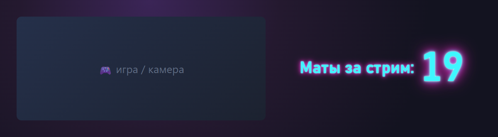
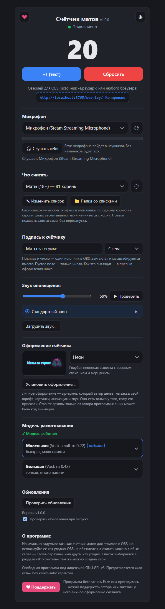
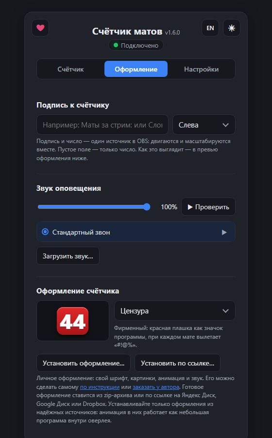
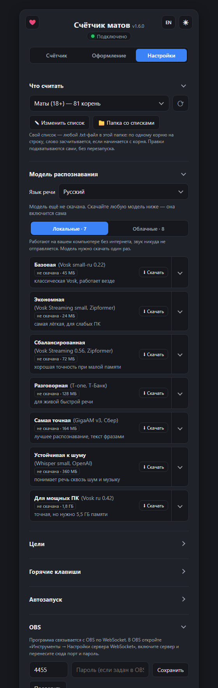
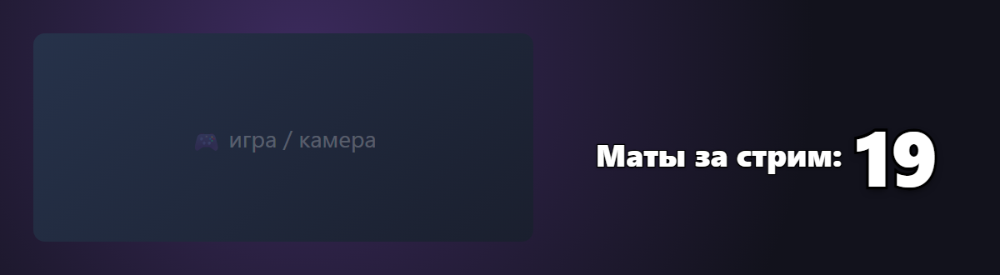
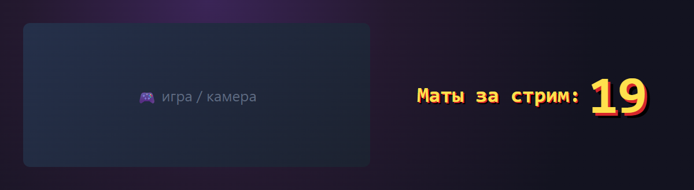

# Счётчик матов

**Слушает микрофон, сам считает маты (или любые другие слова) и показывает счёт на экране.**

> [!IMPORTANT]
> **🔒 Ваш голос не записывается и никуда не уходит.** Речь распознаётся прямо на вашем
> компьютере, без серверов и облаков. Программа не сохраняет ни звук, ни текст сказанного:
> на диске остаются только счёт, статистика по найденным словам и настройки. Подробнее в разделе [Приватность](#-приватность).

Ругнулся, и на экране "+1" со звуком "дилинь". Не нужно жать кнопки или вести счёт вручную:
программа слушает микрофон и считает сама.

Изначально программа задумывалась как оверлей для стримов в OBS: для челленджей
"стрим без мата", донат-штрафов за каждое слово и просто ради смеха. Но используйте её
как угодно: OBS не обязателен, а считать можно не только маты. Есть готовый список
слов-паразитов ("короче", "типа"), а можно считать имя друга или любое другое слово
(как это сделать, описано в "Вопросах и ответах").
Счёт виден прямо в окне программы, а оверлей открывается в любом браузере.

## Возможности

- 🎙 **Считает по голосу.** Распознаёт русскую речь и находит нужные слова в разных формах.
- 🔒 **Голос не записывается.** Речь распознаётся прямо на компьютере, без интернета.
  Звук и текст сказанного не сохраняются и никуда не отправляются.
- 🎨 **6 оформлений.** Классика, неон, ретро, минимализм и другие. Меняются на лету, без перезапуска OBS.
- ✏️ **Подпись к числу.** "Маты за стрим:", "Слова-паразиты:" или любая другая, слева, справа, сверху или снизу.
- 🔔 **Звук оповещения.** Стандартный или свой (MP3/WAV/OGG), громкость регулируется. Звук идёт в микшер OBS.
- 💾 **Счёт не теряется.** Он сохраняется после перезапуска программы или компьютера.
- 🖱 **Ручное управление.** Кнопки "+1" и "Сбросить", если нужно поправить счёт.
- ⏸ **Пауза распознавания** в окне и в трее: на перерыв, катсцену или чужой голос.
- ⏱ **Таймер "без мата".** Сколько удалось продержаться и рекорд за сессию: в окне программы
  и отдельным источником для OBS.
- 🎯 **Цели и пороги.** Звёзды и фанфары на 10-м, 50-м, 100-м слове (числа настраиваются)
  и отсчёт "осталось N до наказания" для челленджей: в окне программы и отдельным источником.
- 📊 **Статистика сессий.** Сколько слов за каждую сессию, самые частые слова, график
  и выгрузка таблицей CSV для Excel.
- ⌨️ **Горячие клавиши.** "+1", пауза и сброс работают, даже когда окно свёрнуто и вы в игре.
- 📝 **Списки слов.** Готовые "Маты (18+)" и "Слова-паразиты" переключаются в окне программы.
  Свой список можно сделать в обычном текстовом файле, правки подхватываются на ходу.
- 🚀 **Запускается сама.** Вместе с Windows, при запуске OBS или в начале трансляции.
  Можно вместо запуска просто напомнить уведомлением.
- 🧠 **Шесть моделей распознавания.** От экономной до самой точной: скачиваются и удаляются
  в один клик, переключаются без перезапуска.
- 🔄 **Обновляется сама.** Сообщит о новой версии и установит её в один клик.
- ✨ **Личные оформления.** Свой стиль, анимация и звук. Можно сделать самому
  [по инструкции](docs/PRESETS.md) или заказать у автора прямо из программы.

## 🔒 Приватность

Программа слушает микрофон, поэтому коротко о том, что происходит с голосом:

- **Голос обрабатывается только на вашем компьютере.** Модель распознавания скачивается
  один раз и дальше работает без интернета. Звук с микрофона не уходит ни на какие
  серверы: ни автору, ни сторонним сервисам.
- **Ничего не записывается.** Программа не сохраняет звук и не ведёт расшифровку:
  распознанная фраза сразу проверяется на нужные слова и забывается. На диске остаются
  только счёт, настройки, ваши списки слов, технический журнал, в котором нет сказанного,
  и статистика: время каждой сессии и сколько раз прозвучал каждый корень из списка слов
  (без остального текста). Статистику можно очистить кнопкой в окне программы.
- **Окно программы и оверлей доступны только с этого компьютера.** Встроенный сервер
  работает на адресе `localhost`, а сторонние сайты, открытые в браузере, не могут к нему обратиться.
- **Интернет нужен только** для скачивания модели, проверки обновлений на GitHub и установки
  оформления по ссылке. Ссылки на поддержку автора и сайт почты открываются, только
  когда вы сами их нажимаете.
- **Это можно проверить.** Код программы открыт и лежит в этом репозитории.

## 🛠 В планах

- 🌍 **Английский язык.** Интерфейс на английском и распознавание английской речи
  со своими списками слов.
- 🧠 **Другие движки распознавания.** Сейчас на выбор шесть моделей Vosk, от экономной
  до самой точной. Следующий шаг: Whisper и GigaAM, они лучше справляются с быстрой речью и шумом.
- 🔢 **Несколько счётчиков сразу.** Например, маты и слова-паразиты отдельно, каждый
  со своим оверлеем и оформлением.
- 📡 **Связь с OBS и стрим-сервисами.** Автосброс при старте записи или трансляции, смена сцены по порогу,
  команда `!маты` в чате Twitch, события для Streamer.bot.
- 🍎 **macOS и Linux**, а не только Windows.

Порядок не окончательный. Если хотите что-то ещё, напишите в [Issues](https://github.com/vvallikk/SwearCounter/issues).

## Как это выглядит

<table>
<tr>
<td width="33%" valign="top"></td>
<td width="33%" valign="top"></td>
<td width="33%" valign="top"></td>
</tr>
</table>

**Окно программы.** Здесь всё настраивается, по трём вкладкам. "Счётчик": счёт и микрофон
(с индикатором громкости и прослушиванием себя). "Оформление": подпись, звук и оформление
с живым превью. "Настройки": что считать, модель распознавания, автозапуск и обновления.
Если закрыть окно, программа спрячется в трей и продолжит считать.

**Оформления в OBS:**

## Быстрый старт

1. **Скачайте** `SwearCounter-vX.Y.Z-windows.zip` со страницы
   [последнего релиза](https://github.com/vvallikk/SwearCounter/releases/latest) и распакуйте в любую папку.
2. **Запустите** `SwearCounter.exe`. Ничего устанавливать не нужно.
3. **Скачайте модель распознавания** на вкладке "Настройки": нажмите "⬇ Скачать" у нужной.
   Первая скачанная модель включится сама, а между скачанными можно переключаться щелчком по карточке.
   Все модели бесплатные, работают без интернета и обучены на русской речи:

   | Модель                              | Скачать | Нужно памяти | Когда брать                                        |
   |-------------------------------------|---------|--------------|----------------------------------------------------|
   | Базовая (Vosk small-ru 0.22)        | 45 МБ   | ~0,3 ГБ      | работает везде, но распознаёт хуже остальных       |
   | Экономная (Vosk Streaming small)    | 24 МБ   | ~0,15 ГБ     | слабый ПК или игра требует много ресурсов          |
   | Сбалансированная (Vosk Streaming)   | 72 МБ   | ~0,2 ГБ      | точнее экономной, памяти всё ещё мало              |
   | Разговорная (T-one от Т-Банка)      | 128 МБ  | ~0,5 ГБ      | быстрая и не очень чёткая речь                     |
   | Самая точная (GigaAM v3 от Сбера)   | 164 МБ  | ~0,4 ГБ      | одна из самых точных, текст появляется фразами     |
   | Для мощных ПК (Vosk ru 0.42)        | 1,8 ГБ  | ~5,5 ГБ      | точная, если памяти много                          |

4. **Выберите микрофон** (если стримите, то тот же, что использует OBS).
5. **Готово.** Счёт виден в окне программы. Чтобы вывести его на стрим, добавьте оверлей
   в OBS (ниже); можно и просто открыть адрес оверлея в браузере.

> Windows может предупредить о неизвестном издателе ("Windows защитила ваш компьютер").
> Нажмите "Подробнее", затем "Выполнить в любом случае".
> Проверить архив можно по SHA-256 и отчёту VirusTotal в описании релиза.

## Добавление в OBS

1. В "Источниках" нажмите **+** и выберите **Браузер**.
2. **URL:** `http://localhost:8765/overlay/`. Адрес можно скопировать кнопкой в окне программы
   или пунктом "Скопировать адрес оверлея" в меню значка в трее.
3. **Ширина и высота:** например `400` и `250`. Число подстраивается под этот размер,
   поэтому меняйте его здесь, а не растягивайте источник мышкой.
4. Включите **"Управлять звуком через OBS"**, чтобы звук попал в эфир.

Фон оверлея прозрачный. Если программу запустили после OBS, оверлей подключится сам через пару секунд.

<b>Тонкая настройка через адрес оверлея</b>

| Параметр   | Что делает                              | Пример         |
|------------|-----------------------------------------|----------------|
| `size`     | размер числа в пикселях                 | `size=160`     |
| `color`    | цвет числа (hex без `#`)                | `color=ffcc00` |
| `mute=1`   | без звука                               | `mute=1`       |
| `preset`   | закрепить оформление за этим источником | `preset=neon`  |
| `show=timer` | вместо счёта таймер "без мата"        | `show=timer`   |
| `show=goal` | вместо счёта "осталось N" до цели      | `show=goal`    |
| `label`    | подпись к таймеру или цели              | `label=Без мата:` |

Например: `http://localhost:8765/overlay/?size=160&color=ffcc00`. Оформления:
`classic`, `impact`, `neon`, `retro`, `minimal`, `explosion` и другие, полный список есть в окне программы.

## Вопросы и ответы

<b>Нужен ли интернет?</b>

Только чтобы один раз скачать модель распознавания и проверять обновления.
Сам подсчёт работает без интернета: голос не записывается и никуда не отправляется
(подробнее в разделе [Приватность](#-приватность)).

<b>Можно ли без OBS?</b>

Да. Счёт виден прямо в окне программы, а оверлей можно открыть в любом браузере
по адресу из окна программы. OBS нужен, только чтобы вывести счёт на стрим.

<b>Как считать другие слова вместо матов?</b>

На вкладке "Настройки" в разделе "Что считать" выберите список: "Маты (18+)" (по умолчанию) или "Слова-паразиты".
Чтобы считать своё, нажмите "📁 Папка со списками" и создайте там любой `.txt`-файл
(или поправьте готовый кнопкой "✎ Изменить список"). В нём по одному корню на строку:
слово засчитывается, если начинается с одного из корней (регистр и ё/е не важны).
Например, корень `вася` засчитает "Вася" и "Васян". Строки, начинающиеся с `#`,
пропускаются; первой строкой можно задать название: `# Название: Друзья`.
Новый файл появится в списке, когда вы вернётесь в окно программы, а правки
подхватываются сами после сохранения файла.

Корень должен быть одним словом, фразы целиком не ищутся. Слишком короткий корень
засчитает лишнее: `ну` поймает и "нужно", и "нулевой".

<b>Считает не все маты / считает лишнее</b>

Попробуйте модель точнее: "Самую точную" (GigaAM), "Сбалансированную" или "Для мощных ПК". Список можно поправить кнопкой
"✎ Изменить список" в разделе "Что считать" (см. вопрос выше): добавьте недостающий корень
или уберите тот, что ловит обычные слова. Изменения подхватываются сами
в течение секунды после сохранения файла, перезапускать программу не нужно.

<b>Счётчик не меняется</b>

- Посмотрите на полосу громкости под выбором микрофона: если она не двигается, когда вы
  говорите, выбран не тот микрофон.
- Кнопка "🎧 Слушать себя" выводит микрофон в наушники, так легко проверить, что он правильный.
- В разделе "Модель распознавания" должно быть "✓ Модель работает". Пока модель загружается
  (большая грузится до пары минут), маты не считаются.

<b>Оверлей в OBS пустой</b>

Проверьте, что программа запущена (значок в трее). Если порт 8765 был занят, программа
запустится на другом порту и покажет уведомление с новым адресом. Поменяйте URL в OBS.

<b>Как запускать программу автоматически?</b>

На вкладке "Настройки" в разделе "Автозапуск":

- **Запускать вместе с Windows.** Программа стартует свёрнутой в трей.
- **Когда запускается OBS** и **когда начинается трансляция.** Для каждого события можно
  выбрать: ничего не делать, напомнить уведомлением или сразу запустить счётчик.

Начало трансляции программа узнаёт от OBS по WebSocket. В OBS откройте
"Инструменты → Настройки сервера WebSocket", включите сервер и перенесите порт и пароль
в окно программы, затем нажмите "Проверить".

Пока счётчик закрыт, OBS ждёт маленький фоновый процесс без окна и без микрофона.
Он выходит, когда счётчик запущен, и снова начинает ждать после выхода из счётчика.

<b>Как удалить ненужную модель?</b>

На вкладке "Настройки" в разделе "Модель распознавания" нажмите 🗑 у скачанной модели
и подтвердите повторным нажатием. Модель, которая сейчас выбрана, удалить нельзя: сначала
переключитесь на другую. Удалённую модель можно скачать снова в любой момент.

<b>Как закрыть программу?</b>

Крестик прячет окно в трей, чтобы счёт не прерывался. Чтобы выйти совсем,
нажмите правой кнопкой на значок в трее и выберите "Выход".

<b>Как обновиться? Не пропадут ли настройки?</b>

Когда выйдет новая версия, рядом с номером версии в окне появится плашка "Доступна vX.Y.Z".
Нажмите "Скачать и установить", затем "Перезапустить и обновить". Счёт, настройки, звуки,
модели, списки слов и личные оформления сохраняются. Проверить вручную можно в разделе "Обновления" на вкладке "Настройки" или в меню трея.

Обычное обновление можно пропустить. Если обновление обязательное (например, исправляет
серьёзную ошибку), плашка красная, а программа не считает слова, пока вы не обновитесь.

<b>Где хранятся мои данные?</b>

Всё рядом с `SwearCounter.exe`: счёт (`counter.json`), статистика (`stats.json`), настройки (`settings.json`),
звуки (`sounds/`), списки слов (`wordlists/`), личные оформления (`presets/`),
модели (`models/`) и журнал работы
(`swearcounter.log`, пригодится при сообщении об ошибке). Чтобы перенести программу, просто скопируйте папку целиком.

<b>Можно ли своё, уникальное оформление?</b>

Да, есть два способа.

- **Сделать самому.** Оформление это папка с `preset.json`, стилями, картинками, шрифтами
  и звуком. Как её собрать и проверить, описано в [docs/PRESETS.md](docs/PRESETS.md).
- **Заказать у автора.** В разделе "Оформление" нажмите "заказать у автора", укажите почту
  для связи и опишите, каким должно быть оформление. Программа подготовит письмо: откроет его
  в почтовой программе, а если её нет, предложит сайт вашей почты (Gmail, Яндекс Почта,
  Почта Mail, Outlook и другие) с уже заполненным письмом. Останется его отправить.
  Автор ответит и обсудит сроки и цену.
  Такое оформление делается только для вас, с вашим именем в описании.

Готовое оформление приходит zip-архивом. Чтобы установить, нажмите "Установить оформление..." в разделе "Оформление" и выберите
архив. Если автор прислал ссылку на Яндекс Диск, Google Диск или Dropbox, нажмите
"Установить по ссылке..." и вставьте её: скачивать архив вручную не нужно. После установки
оформление сразу включается и появляется в списке в группе "Личные оформления". Набор
хранится в папке `presets/` рядом с программой и не пропадает при обновлении.

Устанавливайте только оформления из надёжных источников: анимация в них работает как
небольшая программа внутри оверлея.
Как устроен набор, описано в [docs/PRESETS.md](docs/PRESETS.md).

<b>Как поддержать автора?</b>

Программа бесплатная и останется такой. Если она пригодилась, ссылки и QR-коды
есть в разделе ["Поддержать автора"](#поддержать-автора). В программе это кнопка "❤ Поддержать"
в разделе "О программе", сердечко в углу окна или меню значка в трее.
Там же можно заказать личное оформление.

<b>В программе есть нецензурные слова?</b>

Да: встроенный список "Маты (18+)" содержит корни нецензурных слов, он лежит в
`wordlists/swears.txt` и включён по умолчанию, раз программа задумывалась как счётчик матов.
Если это не нужно, просто выберите "Слова-паразиты" или свой список.
Сама программа ничего не произносит и не показывает: на экране только число.

## Поддержать автора

Программа бесплатная и останется такой. Если она пригодилась, можно поддержать автора
или заказать у него личное оформление счётчика:

| [Boosty](https://boosty.to/walikk/single-payment/donation/834276/target?share=target_link) | [DonationAlerts](https://www.donationalerts.com/r/vvalikk) |
|:---:|:---:|
|  |  |

## Сообщить о проблеме

Опишите, что случилось, в [Issues](https://github.com/vvallikk/SwearCounter/issues)
и приложите `swearcounter.log` из папки программы.

## Благодарности

Распознавание речи работает на открытых библиотеках и моделях:

- [Vosk](https://alphacephei.com/vosk/): библиотека и модели Vosk и Vosk Streaming от
  [Alpha Cephei](https://alphacephei.com/). Они являются собственностью Alpha Cephei Inc.
  и распространяются по лицензии [Apache 2.0](https://github.com/alphacep/vosk-api/blob/master/COPYING).
- [sherpa-onnx](https://github.com/k2-fsa/sherpa-onnx) от команды k2-fsa (Apache 2.0):
  запускает модели Vosk Streaming, T-one и GigaAM.
- [T-one](https://github.com/voicekit-team/T-one) от Т-Банка (Apache 2.0).
- [GigaAM](https://github.com/salute-developers/GigaAM) от Сбера (MIT).
- [Silero VAD](https://github.com/snakers4/silero-vad) от команды Silero (MIT):
  находит фразы в речи для модели GigaAM.

Спасибо их авторам за то, что качественное офлайн-распознавание русской речи доступно всем бесплатно.

## Лицензия

Программа распространяется под свободной лицензией [GNU GPL v3](LICENSE): её можно
использовать, изучать, изменять и распространять, в том числе изменённую, но только
под той же лицензией и с открытым исходным кодом. Лицензии сторонних компонентов,
вошедших в программу, лежат в файле `THIRD_PARTY_LICENSES.txt` в архиве с программой.

Программа предоставляется "как есть", без каких-либо гарантий. Автор не отвечает за
последствия её использования; за то, как и где её применять, отвечает пользователь
(подробнее в разделах 15-17 лицензии).

---

Для разработчиков: [сборка, архитектура и выпуск релизов](docs/DEVELOPMENT.md).
[Политика подписи кода · Code signing policy](docs/CODE_SIGNING.md).
